# Test-Driven Development (TDD) Guide

## 🎯 Overview

This project follows a modified Test-Driven Development (TDD) approach optimized for TypeScript development. We write functions first, ensure type safety, then create comprehensive tests. This approach ensures high code quality, type safety, and maintainable architecture while leveraging TypeScript's compile-time error checking.

## 🔄 The Modified TDD Cycle

### IMPLEMENT → TYPECHECK → TEST → REFACTOR

1. **🔧 IMPLEMENT**: Write the function implementation
2. **🔍 TYPECHECK**: Run TypeScript compiler to catch type errors
3. **🔴 TEST**: Write comprehensive tests for all scenarios
4. **🔵 REFACTOR**: Improve code while keeping tests green

### Detailed Process

```mermaid
graph LR
    A[Write Function Implementation] --> B[Run TypeScript Check]
    B --> C[Fix Type Errors]
    C --> D[TypeScript Clean?]
    D -->|No| C
    D -->|Yes| E[Write Test Scenarios]
    E --> F[Write First Test]
    F --> G[Run Test - Should Pass]
    G --> H[Write Next Test Scenario]
    H --> I[All Scenarios Tested?]
    I -->|No| F
    I -->|Yes| J[Run All Tests]
    J --> K[Refactor Implementation]
    K --> L[Run All Tests Again]
    L --> M[Next Function]
    M --> A
```



## ⚡ Modified TDD Workflow

### One Function at a Time Approach

**Core Principle**: Implement and test one function completely before moving to the next.

#### Step-by-Step Process:

1. **🔧 IMPLEMENT**: Write the complete function implementation
   - Focus on correct logic and edge case handling
   - Use TypeScript types for compile-time safety
   - Write clean, readable code from the start

2. **🔍 TYPECHECK**: Run TypeScript compiler
   ```bash
   npx tsc --noEmit
   ```
   - Fix any type errors immediately
   - Ensure type safety before proceeding

3. **🔴 TEST**: Write comprehensive tests
   - **First**: Identify all test scenarios (happy path, edge cases, error cases)
   - **Then**: Write tests one by one for each scenario
   - **Run**: Each test should pass immediately (since function is implemented)

4. **🔵 REFACTOR**: Improve implementation if needed
   - Tests act as safety net during refactoring
   - Maintain test coverage throughout refactoring

### Benefits of This Approach:

- **✅ Type Safety First**: Catch type errors before testing
- **✅ Complete Coverage**: Think through all scenarios upfront  
- **✅ Faster Development**: No red-green cycle delays
- **✅ Better Design**: Focus on implementation quality from start
- **✅ TypeScript Optimized**: Leverages compile-time checking

## 🧪 TDD Implementation Strategy

### Phase 1: Foundation Testing (Weeks 1-2)
**Objective**: Establish testing infrastructure and core utilities

#### 1.1 Testing Setup
```bash
# Install testing dependencies
npm install --save-dev jest @testing-library/react-native @testing-library/jest-native
npm install --save-dev jest-expo react-test-renderer
```

#### 1.2 Test Configuration
```typescript
// jest.config.js
module.exports = {
  preset: 'jest-expo',
  setupFilesAfterEnv: ['<rootDir>/test/setup.ts'],
  testMatch: ['**/__tests__/**/*.(ts|tsx|js)', '**/*.(test|spec).(ts|tsx|js)'],
  collectCoverageFrom: [
    'app/**/*.{ts,tsx}',
    '!app/**/*.d.ts',
    '!app/i18n/**',
    '!app/theme/**',
  ],
  coverageThreshold: {
    global: {
      branches: 80,
      functions: 80,
      lines: 80,
      statements: 80,
    },
  },
};
```

#### 1.3 Global Test Setup
```typescript
// test/setup.ts
import '@testing-library/jest-native/extend-expect';
import 'react-native-gesture-handler/jestSetup';

// Mock React Native modules
jest.mock('react-native/Libraries/EventEmitter/NativeEventEmitter');
jest.mock('react-native/Libraries/Animated/NativeAnimatedHelper');

// Mock Expo modules
jest.mock('expo-constants', () => ({
  default: {
    appOwnership: 'standalone',
    manifest: {},
  },
}));

// Mock MobX State Tree
jest.mock('@/models', () => ({
  useStores: () => ({
    authenticationStore: {
      isAuthenticated: false,
      authToken: null,
      setAuthToken: jest.fn(),
      logout: jest.fn(),
    },
    episodeStore: {
      episodes: [],
      favorites: [],
      addFavorite: jest.fn(),
      removeFavorite: jest.fn(),
    },
  }),
}));
```

### Phase 2: Utility Function Testing (Week 3)
**Objective**: Test all utility functions with TDD approach

#### 2.1 Example: Email Validation Modified TDD
```typescript
// STEP 1: IMPLEMENT - Write the function first
// app/utils/validation/emailValidation.ts
export function validateEmail(email: string): boolean {
  if (!email?.trim()) return false;
  
  const emailRegex = /^[a-zA-Z0-9._%+-]+@[a-zA-Z0-9.-]+\.[a-zA-Z]{2,}$/;
  return emailRegex.test(email.trim());
}
```

```bash
# STEP 2: TYPECHECK - Run TypeScript compiler
npx tsc --noEmit
# ✅ No type errors found
```

```typescript
// STEP 3: TEST - Identify test scenarios first
/**
 * Test scenarios for validateEmail:
 * 1. Valid email formats
 * 2. Invalid email formats  
 * 3. Empty/null/undefined inputs
 * 4. Whitespace handling
 * 5. Edge cases (very long emails, special characters)
 */

// app/utils/validation/emailValidation.test.ts
import { validateEmail } from './emailValidation';

describe('validateEmail', () => {
  describe('valid email formats', () => {
    it('should return true for standard email', () => {
      expect(validateEmail('test@example.com')).toBe(true);
    });

    it('should return true for email with subdomain', () => {
      expect(validateEmail('user@mail.example.com')).toBe(true);
    });

    it('should return true for email with numbers', () => {
      expect(validateEmail('user123@example123.com')).toBe(true);
    });

    it('should return true for email with dots and underscores', () => {
      expect(validateEmail('user.name_test@example.co.uk')).toBe(true);
    });
  });

  describe('invalid email formats', () => {
    it('should return false for email without @', () => {
      expect(validateEmail('testexample.com')).toBe(false);
    });

    it('should return false for email without domain', () => {
      expect(validateEmail('test@')).toBe(false);
    });

    it('should return false for email without local part', () => {
      expect(validateEmail('@example.com')).toBe(false);
    });

    it('should return false for email with spaces', () => {
      expect(validateEmail('test @example.com')).toBe(false);
    });
  });

  describe('empty/null/undefined inputs', () => {
    it('should return false for empty string', () => {
      expect(validateEmail('')).toBe(false);
    });

    it('should return false for undefined', () => {
      expect(validateEmail(undefined as any)).toBe(false);
    });

    it('should return false for null', () => {
      expect(validateEmail(null as any)).toBe(false);
    });
  });

  describe('whitespace handling', () => {
    it('should return true for email with leading/trailing spaces', () => {
      expect(validateEmail('  test@example.com  ')).toBe(true);
    });

    it('should return false for only whitespace', () => {
      expect(validateEmail('   ')).toBe(false);
    });
  });
});
```

```bash
# STEP 4: Run tests to verify implementation
npm test emailValidation.test.ts
# ✅ All tests pass

# STEP 5: REFACTOR if needed (optional)
# Implementation is already clean and efficient
```

#### 2.2 Utility Functions to Test
- `validateEmail(email: string): boolean`
- `validatePassword(password: string): { isValid: boolean; errors: string[] }`
- `formatDate(date: Date, format: string): string`
- `generateId(): string`
- `sanitizeInput(input: string): string`
- `calculateDistance(lat1: number, lon1: number, lat2: number, lon2: number): number`

### Phase 3: Component Testing (Weeks 4-5)
**Objective**: Test React Native components with TDD

#### 3.1 Example: Button Component TDD
```typescript
// app/components/Button.test.tsx
import React from 'react';
import { render, fireEvent } from '@testing-library/react-native';
import { Button } from './Button';

describe('Button', () => {
  // RED: Write failing test
  it('should render with text', () => {
    const { getByText } = render(<Button text="Click Me" />);
    expect(getByText('Click Me')).toBeTruthy();
  });

  // Component doesn't exist yet, test will fail
});
```

```typescript
// app/components/Button.tsx
// GREEN: Create minimal component
import React from 'react';
import { TouchableOpacity, Text } from 'react-native';

interface ButtonProps {
  text: string;
}

export const Button: React.FC<ButtonProps> = ({ text }) => {
  return (
    <TouchableOpacity>
      <Text>{text}</Text>
    </TouchableOpacity>
  );
};
```

```typescript
// app/components/Button.test.tsx
describe('Button', () => {
  // RED: Add more test cases
  it('should render with text', () => {
    const { getByText } = render(<Button text="Click Me" />);
    expect(getByText('Click Me')).toBeTruthy();
  });

  it('should call onPress when pressed', () => {
    const mockOnPress = jest.fn();
    const { getByText } = render(<Button text="Click Me" onPress={mockOnPress} />);
    
    fireEvent.press(getByText('Click Me'));
    expect(mockOnPress).toHaveBeenCalledTimes(1);
  });

  it('should be disabled when disabled prop is true', () => {
    const mockOnPress = jest.fn();
    const { getByText } = render(
      <Button text="Click Me" onPress={mockOnPress} disabled={true} />
    );
    
    fireEvent.press(getByText('Click Me'));
    expect(mockOnPress).not.toHaveBeenCalled();
  });
});
```

#### 3.2 Components to Test
- `Button` - Basic button with press handling
- `TextField` - Input field with validation
- `Card` - Container component
- `ListItem` - List row component
- `Modal` - Modal dialog component
- `LoadingSpinner` - Loading indicator

### Phase 4: Store Testing (Week 6)
**Objective**: Test MobX State Tree stores with TDD

#### 4.1 Example: AuthenticationStore TDD
```typescript
// app/models/AuthenticationStore.test.ts
import { AuthenticationStoreModel } from './AuthenticationStore';

describe('AuthenticationStore', () => {
  let store: any;

  beforeEach(() => {
    store = AuthenticationStoreModel.create({});
  });

  // RED: Write failing test
  it('should initialize with no auth token', () => {
    expect(store.authToken).toBeNull();
    expect(store.isAuthenticated).toBe(false);
  });

  // Store doesn't exist yet, test will fail
});
```

```typescript
// app/models/AuthenticationStore.ts
// GREEN: Create minimal store
import { types, Instance, SnapshotOut } from 'mobx-state-tree';

export const AuthenticationStoreModel = types
  .model('AuthenticationStore')
  .props({
    authToken: types.maybeNull(types.string),
  })
  .views((self) => ({
    get isAuthenticated() {
      return !!self.authToken;
    },
  }));

export interface AuthenticationStore extends Instance<typeof AuthenticationStoreModel> {}
export interface AuthenticationStoreSnapshot extends SnapshotOut<typeof AuthenticationStoreModel> {}
```

### Phase 5: Screen Testing (Week 7)
**Objective**: Test screen components with TDD

#### 5.1 Example: LoginScreen TDD
```typescript
// app/screens/LoginScreen.test.tsx
import React from 'react';
import { render, fireEvent, waitFor } from '@testing-library/react-native';
import { LoginScreen } from './LoginScreen';

describe('LoginScreen', () => {
  // RED: Write failing test
  it('should render login form', () => {
    const { getByPlaceholderText, getByText } = render(<LoginScreen />);
    
    expect(getByPlaceholderText('Email')).toBeTruthy();
    expect(getByPlaceholderText('Password')).toBeTruthy();
    expect(getByText('Login')).toBeTruthy();
  });

  // Screen doesn't exist yet, test will fail
});
```

### Phase 6: Integration Testing (Week 8)
**Objective**: Test component integration with stores

#### 6.1 Example: Login Flow Integration Test
```typescript
// app/screens/LoginScreen.integration.test.tsx
import React from 'react';
import { render, fireEvent, waitFor } from '@testing-library/react-native';
import { LoginScreen } from './LoginScreen';
import { RootStoreProvider } from '@/models';
import { createMockRootStore } from '@/test/mocks';

describe('LoginScreen Integration', () => {
  it('should login user and navigate to main screen', async () => {
    const mockStore = createMockRootStore();
    const mockNavigate = jest.fn();

    const { getByPlaceholderText, getByText } = render(
      <RootStoreProvider value={mockStore}>
        <LoginScreen navigation={{ navigate: mockNavigate }} />
      </RootStoreProvider>
    );

    fireEvent.changeText(getByPlaceholderText('Email'), 'test@example.com');
    fireEvent.changeText(getByPlaceholderText('Password'), 'password123');
    fireEvent.press(getByText('Login'));

    await waitFor(() => {
      expect(mockStore.authenticationStore.authToken).toBeTruthy();
      expect(mockNavigate).toHaveBeenCalledWith('Main');
    });
  });
});
```

## 📋 TDD Best Practices

### 1. Test Structure
```typescript
describe('FeatureName', () => {
  describe('when condition', () => {
    it('should do something', () => {
      // Arrange
      const input = 'test';
      
      // Act
      const result = functionUnderTest(input);
      
      // Assert
      expect(result).toBe(expected);
    });
  });
});
```

### 2. Test Naming Convention
- **Feature/Component**: `describe('Button', () => {})`
- **Scenario**: `describe('when disabled', () => {})`
- **Expected behavior**: `it('should not respond to press', () => {})`

### 3. Mock Strategy
```typescript
// Mock external dependencies
jest.mock('@/services/api', () => ({
  login: jest.fn(),
  fetchUser: jest.fn(),
}));

// Mock React Native modules
jest.mock('react-native/Libraries/Alert/Alert', () => ({
  alert: jest.fn(),
}));
```

### 4. Test Data Factories
```typescript
// test/factories/userFactory.ts
export const createMockUser = (overrides = {}) => ({
  id: 'user-1',
  email: 'test@example.com',
  name: 'Test User',
  createdAt: new Date(),
  ...overrides,
});
```

## 🚀 Running Tests

### Development Commands
```bash
# Run all tests
bun test

# Run tests in watch mode
bun test --watch

# Run tests with coverage
bun test --coverage

# Run specific test file
bun test Button.test.tsx

# Run tests matching pattern
bun test --testNamePattern="should render"
```

### Test Coverage Goals
- **Minimum**: 80% coverage for all metrics
- **Target**: 90% coverage for critical paths
- **Statements**: 85%
- **Branches**: 80%
- **Functions**: 90%
- **Lines**: 85%

## 📊 TDD Metrics

### Red-Green-Refactor Cycle Time
- **Red Phase**: 2-5 minutes (write failing test)
- **Green Phase**: 5-15 minutes (make test pass)
- **Refactor Phase**: 10-30 minutes (improve code)

### Test-to-Code Ratio
- **Target**: 1:1 (test code equals production code)
- **Minimum**: 0.8:1 (80% test code to production code)

## 🔧 TDD Tools

### Essential Testing Tools
- **Jest**: Test framework
- **React Native Testing Library**: Component testing
- **MSW**: API mocking
- **React Test Renderer**: Component rendering
- **Jest-Expo**: Expo-specific testing utilities

### Development Tools
- **Reactotron**: State inspection
- **Flipper**: Debugging
- **Coverage Reports**: Visual coverage analysis
- **Test Watchers**: Automatic test running

## 🚫 Common Anti-Patterns in Modified TDD

### ❌ Don't Do This
```typescript
// Writing incomplete implementation
export function calculateTotal(items: Item[]): number {
  // TODO: implement later
  return 0;
}

// Then writing tests that fail
it('should calculate total', () => {
  expect(calculateTotal(items)).toBe(100); // This will fail
});
```

### ❌ Also Don't Do This
```typescript
// Skipping TypeScript check
export function calculateTotal(items: any): number {
  return items.reduce((sum, item) => sum + item.price, 0);
}

// Missing proper typing leads to runtime errors
```

### ❌ Writing Tests Without Planning Scenarios
```typescript
// Random tests without thinking through scenarios
it('should work', () => {
  expect(calculateTotal([])).toBe(0);
});

it('should do something', () => {
  expect(calculateTotal([{price: 10}])).toBe(10);
});
```

### ✅ Do This Instead - Modified TDD Approach
```typescript
// STEP 1: Write complete, well-typed implementation
interface Item {
  id: string;
  price: number;
}

export function calculateTotal(items: Item[]): number {
  if (!items || items.length === 0) return 0;
  return items.reduce((sum, item) => sum + (item?.price || 0), 0);
}

// STEP 2: Check TypeScript
// npx tsc --noEmit ✅

// STEP 3: Plan test scenarios first
/**
 * Test scenarios:
 * 1. Empty array
 * 2. Single item
 * 3. Multiple items
 * 4. Items with zero price
 * 5. Invalid items (null/undefined price)
 */

// STEP 4: Write comprehensive tests
describe('calculateTotal', () => {
  describe('empty inputs', () => {
    it('should return 0 for empty array', () => {
      expect(calculateTotal([])).toBe(0);
    });

    it('should return 0 for null items', () => {
      expect(calculateTotal(null as any)).toBe(0);
    });
  });

  describe('valid calculations', () => {
    it('should calculate total for single item', () => {
      const items = [{ id: '1', price: 25 }];
      expect(calculateTotal(items)).toBe(25);
    });

    it('should calculate total for multiple items', () => {
      const items = [
        { id: '1', price: 25 },
        { id: '2', price: 75 },
      ];
      expect(calculateTotal(items)).toBe(100);
    });
  });

  describe('edge cases', () => {
    it('should handle items with zero price', () => {
      const items = [
        { id: '1', price: 0 },
        { id: '2', price: 50 },
      ];
      expect(calculateTotal(items)).toBe(50);
    });

    it('should handle items with invalid price', () => {
      const items = [
        { id: '1', price: null as any },
        { id: '2', price: 50 },
      ];
      expect(calculateTotal(items)).toBe(50);
    });
  });
});
```

## 📈 TDD Success Metrics

### Code Quality Indicators
- **Bug Density**: < 0.1 bugs per KLOC
- **Test Coverage**: > 85% across all metrics
- **Cyclomatic Complexity**: < 10 per function
- **Technical Debt**: < 5% of total development time

### Development Velocity
- **Feature Completion**: Consistent sprint velocity
- **Bug Fix Time**: < 2 hours average
- **Refactoring Confidence**: High (due to test coverage)
- **Code Review Time**: Reduced (tests document behavior)

## 🎯 TDD Implementation Timeline

### Week 1: Foundation
- [ ] Set up testing infrastructure
- [ ] Create test configuration
- [ ] Establish testing conventions
- [ ] Write first utility function tests

### Week 2: Utilities
- [ ] Test all utility functions
- [ ] Achieve 90% utility test coverage
- [ ] Establish testing patterns
- [ ] Create test data factories

### Week 3-4: Components
- [ ] Test all UI components
- [ ] Achieve 85% component test coverage
- [ ] Test component interactions
- [ ] Mock external dependencies

### Week 5-6: State Management
- [ ] Test all MST stores
- [ ] Test store actions and views
- [ ] Test store integrations
- [ ] Achieve 90% store test coverage

### Week 7-8: Screens & Integration
- [ ] Test all screen components
- [ ] Test navigation flows
- [ ] Test end-to-end scenarios
- [ ] Achieve overall 85% coverage

## 💡 TDD Tips for React Native

1. **Start Small**: Begin with utility functions
2. **Mock Early**: Mock React Native modules upfront
3. **Test Behavior**: Focus on what components do, not how
4. **Use Real Data**: Test with realistic data structures
5. **Test Edge Cases**: Handle errors and empty states
6. **Keep Tests Fast**: Isolate external dependencies
7. **Refactor Fearlessly**: Trust your tests during refactoring

---

**Remember**: In our Modified TDD approach:
1. **Implementation comes first** - write complete, well-typed functions
2. **TypeScript checking is mandatory** - ensure type safety before testing  
3. **Test scenarios are planned upfront** - think through all cases before writing tests
4. **One function at a time** - complete implementation and testing before moving to next function
5. **Tests validate implementation** - comprehensive coverage ensures correctness

This approach leverages TypeScript's strengths while maintaining the quality benefits of TDD.

**Next Steps**: Start with [Testing Strategy](./testing-strategy.md) to understand the broader testing approach, then begin implementing Modified TDD with utility functions.