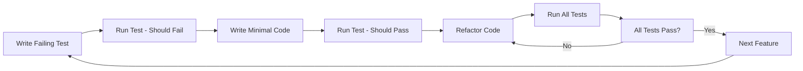

# Test-Driven Development (TDD) Guide

## 🎯 Overview

This project strictly follows Test-Driven Development (TDD) principles. Every line of code is written only after a failing test has been created. This approach ensures high code quality, comprehensive test coverage, and maintainable architecture.

## 🔄 The TDD Cycle

### RED → GREEN → REFACTOR

1. **🔴 RED**: Write a failing test
2. **🟢 GREEN**: Write minimal code to make the test pass
3. **🔵 REFACTOR**: Improve code while keeping tests green

### Detailed Process



## 🧪 TDD Implementation Strategy

### Phase 1: Foundation Testing (Weeks 1-2)
**Objective**: Establish testing infrastructure and core utilities

#### 1.1 Testing Setup
```bash
# Install testing dependencies
npm install --save-dev jest @testing-library/react-native @testing-library/jest-native
npm install --save-dev jest-expo react-test-renderer
```

#### 1.2 Test Configuration
```typescript
// jest.config.js
module.exports = {
  preset: 'jest-expo',
  setupFilesAfterEnv: ['<rootDir>/test/setup.ts'],
  testMatch: ['**/__tests__/**/*.(ts|tsx|js)', '**/*.(test|spec).(ts|tsx|js)'],
  collectCoverageFrom: [
    'app/**/*.{ts,tsx}',
    '!app/**/*.d.ts',
    '!app/i18n/**',
    '!app/theme/**',
  ],
  coverageThreshold: {
    global: {
      branches: 80,
      functions: 80,
      lines: 80,
      statements: 80,
    },
  },
};
```

#### 1.3 Global Test Setup
```typescript
// test/setup.ts
import '@testing-library/jest-native/extend-expect';
import 'react-native-gesture-handler/jestSetup';

// Mock React Native modules
jest.mock('react-native/Libraries/EventEmitter/NativeEventEmitter');
jest.mock('react-native/Libraries/Animated/NativeAnimatedHelper');

// Mock Expo modules
jest.mock('expo-constants', () => ({
  default: {
    appOwnership: 'standalone',
    manifest: {},
  },
}));

// Mock MobX State Tree
jest.mock('@/models', () => ({
  useStores: () => ({
    authenticationStore: {
      isAuthenticated: false,
      authToken: null,
      setAuthToken: jest.fn(),
      logout: jest.fn(),
    },
    episodeStore: {
      episodes: [],
      favorites: [],
      addFavorite: jest.fn(),
      removeFavorite: jest.fn(),
    },
  }),
}));
```

### Phase 2: Utility Function Testing (Week 3)
**Objective**: Test all utility functions with TDD approach

#### 2.1 Example: Email Validation TDD
```typescript
// app/utils/validation/emailValidation.test.ts
import { validateEmail } from './emailValidation';

describe('validateEmail', () => {
  // RED: Write failing test first
  it('should return true for valid email', () => {
    expect(validateEmail('test@example.com')).toBe(true);
  });

  // Test doesn't exist yet, so it will fail
  // Now write minimal implementation
});
```

```typescript
// app/utils/validation/emailValidation.ts
// GREEN: Write minimal code to make test pass
export function validateEmail(email: string): boolean {
  // Minimal implementation
  return email === 'test@example.com';
}
```

```typescript
// app/utils/validation/emailValidation.test.ts
describe('validateEmail', () => {
  // RED: Add more test cases
  it('should return true for valid email', () => {
    expect(validateEmail('test@example.com')).toBe(true);
  });

  it('should return false for invalid email', () => {
    expect(validateEmail('invalid-email')).toBe(false);
  });

  it('should return false for empty string', () => {
    expect(validateEmail('')).toBe(false);
  });
});
```

```typescript
// app/utils/validation/emailValidation.ts
// GREEN: Expand implementation to make all tests pass
export function validateEmail(email: string): boolean {
  if (!email || email.trim() === '') return false;
  
  const emailRegex = /^[^\s@]+@[^\s@]+\.[^\s@]+$/;
  return emailRegex.test(email);
}
```

```typescript
// REFACTOR: Improve implementation
export function validateEmail(email: string): boolean {
  if (!email?.trim()) return false;
  
  const emailRegex = /^[a-zA-Z0-9._%+-]+@[a-zA-Z0-9.-]+\.[a-zA-Z]{2,}$/;
  return emailRegex.test(email.trim());
}
```

#### 2.2 Utility Functions to Test
- `validateEmail(email: string): boolean`
- `validatePassword(password: string): { isValid: boolean; errors: string[] }`
- `formatDate(date: Date, format: string): string`
- `generateId(): string`
- `sanitizeInput(input: string): string`
- `calculateDistance(lat1: number, lon1: number, lat2: number, lon2: number): number`

### Phase 3: Component Testing (Weeks 4-5)
**Objective**: Test React Native components with TDD

#### 3.1 Example: Button Component TDD
```typescript
// app/components/Button.test.tsx
import React from 'react';
import { render, fireEvent } from '@testing-library/react-native';
import { Button } from './Button';

describe('Button', () => {
  // RED: Write failing test
  it('should render with text', () => {
    const { getByText } = render(<Button text="Click Me" />);
    expect(getByText('Click Me')).toBeTruthy();
  });

  // Component doesn't exist yet, test will fail
});
```

```typescript
// app/components/Button.tsx
// GREEN: Create minimal component
import React from 'react';
import { TouchableOpacity, Text } from 'react-native';

interface ButtonProps {
  text: string;
}

export const Button: React.FC<ButtonProps> = ({ text }) => {
  return (
    <TouchableOpacity>
      <Text>{text}</Text>
    </TouchableOpacity>
  );
};
```

```typescript
// app/components/Button.test.tsx
describe('Button', () => {
  // RED: Add more test cases
  it('should render with text', () => {
    const { getByText } = render(<Button text="Click Me" />);
    expect(getByText('Click Me')).toBeTruthy();
  });

  it('should call onPress when pressed', () => {
    const mockOnPress = jest.fn();
    const { getByText } = render(<Button text="Click Me" onPress={mockOnPress} />);
    
    fireEvent.press(getByText('Click Me'));
    expect(mockOnPress).toHaveBeenCalledTimes(1);
  });

  it('should be disabled when disabled prop is true', () => {
    const mockOnPress = jest.fn();
    const { getByText } = render(
      <Button text="Click Me" onPress={mockOnPress} disabled={true} />
    );
    
    fireEvent.press(getByText('Click Me'));
    expect(mockOnPress).not.toHaveBeenCalled();
  });
});
```

#### 3.2 Components to Test
- `Button` - Basic button with press handling
- `TextField` - Input field with validation
- `Card` - Container component
- `ListItem` - List row component
- `Modal` - Modal dialog component
- `LoadingSpinner` - Loading indicator

### Phase 4: Store Testing (Week 6)
**Objective**: Test MobX State Tree stores with TDD

#### 4.1 Example: AuthenticationStore TDD
```typescript
// app/models/AuthenticationStore.test.ts
import { AuthenticationStoreModel } from './AuthenticationStore';

describe('AuthenticationStore', () => {
  let store: any;

  beforeEach(() => {
    store = AuthenticationStoreModel.create({});
  });

  // RED: Write failing test
  it('should initialize with no auth token', () => {
    expect(store.authToken).toBeNull();
    expect(store.isAuthenticated).toBe(false);
  });

  // Store doesn't exist yet, test will fail
});
```

```typescript
// app/models/AuthenticationStore.ts
// GREEN: Create minimal store
import { types, Instance, SnapshotOut } from 'mobx-state-tree';

export const AuthenticationStoreModel = types
  .model('AuthenticationStore')
  .props({
    authToken: types.maybeNull(types.string),
  })
  .views((self) => ({
    get isAuthenticated() {
      return !!self.authToken;
    },
  }));

export interface AuthenticationStore extends Instance<typeof AuthenticationStoreModel> {}
export interface AuthenticationStoreSnapshot extends SnapshotOut<typeof AuthenticationStoreModel> {}
```

### Phase 5: Screen Testing (Week 7)
**Objective**: Test screen components with TDD

#### 5.1 Example: LoginScreen TDD
```typescript
// app/screens/LoginScreen.test.tsx
import React from 'react';
import { render, fireEvent, waitFor } from '@testing-library/react-native';
import { LoginScreen } from './LoginScreen';

describe('LoginScreen', () => {
  // RED: Write failing test
  it('should render login form', () => {
    const { getByPlaceholderText, getByText } = render(<LoginScreen />);
    
    expect(getByPlaceholderText('Email')).toBeTruthy();
    expect(getByPlaceholderText('Password')).toBeTruthy();
    expect(getByText('Login')).toBeTruthy();
  });

  // Screen doesn't exist yet, test will fail
});
```

### Phase 6: Integration Testing (Week 8)
**Objective**: Test component integration with stores

#### 6.1 Example: Login Flow Integration Test
```typescript
// app/screens/LoginScreen.integration.test.tsx
import React from 'react';
import { render, fireEvent, waitFor } from '@testing-library/react-native';
import { LoginScreen } from './LoginScreen';
import { RootStoreProvider } from '@/models';
import { createMockRootStore } from '@/test/mocks';

describe('LoginScreen Integration', () => {
  it('should login user and navigate to main screen', async () => {
    const mockStore = createMockRootStore();
    const mockNavigate = jest.fn();

    const { getByPlaceholderText, getByText } = render(
      <RootStoreProvider value={mockStore}>
        <LoginScreen navigation={{ navigate: mockNavigate }} />
      </RootStoreProvider>
    );

    fireEvent.changeText(getByPlaceholderText('Email'), 'test@example.com');
    fireEvent.changeText(getByPlaceholderText('Password'), 'password123');
    fireEvent.press(getByText('Login'));

    await waitFor(() => {
      expect(mockStore.authenticationStore.authToken).toBeTruthy();
      expect(mockNavigate).toHaveBeenCalledWith('Main');
    });
  });
});
```

## 📋 TDD Best Practices

### 1. Test Structure
```typescript
describe('FeatureName', () => {
  describe('when condition', () => {
    it('should do something', () => {
      // Arrange
      const input = 'test';
      
      // Act
      const result = functionUnderTest(input);
      
      // Assert
      expect(result).toBe(expected);
    });
  });
});
```

### 2. Test Naming Convention
- **Feature/Component**: `describe('Button', () => {})`
- **Scenario**: `describe('when disabled', () => {})`
- **Expected behavior**: `it('should not respond to press', () => {})`

### 3. Mock Strategy
```typescript
// Mock external dependencies
jest.mock('@/services/api', () => ({
  login: jest.fn(),
  fetchUser: jest.fn(),
}));

// Mock React Native modules
jest.mock('react-native/Libraries/Alert/Alert', () => ({
  alert: jest.fn(),
}));
```

### 4. Test Data Factories
```typescript
// test/factories/userFactory.ts
export const createMockUser = (overrides = {}) => ({
  id: 'user-1',
  email: 'test@example.com',
  name: 'Test User',
  createdAt: new Date(),
  ...overrides,
});
```

## 🚀 Running Tests

### Development Commands
```bash
# Run all tests
npm test

# Run tests in watch mode
npm run test:watch

# Run tests with coverage
npm run test:coverage

# Run specific test file
npm test -- Button.test.tsx

# Run tests matching pattern
npm test -- --testNamePattern="should render"
```

### Test Coverage Goals
- **Minimum**: 80% coverage for all metrics
- **Target**: 90% coverage for critical paths
- **Statements**: 85%
- **Branches**: 80%
- **Functions**: 90%
- **Lines**: 85%

## 📊 TDD Metrics

### Red-Green-Refactor Cycle Time
- **Red Phase**: 2-5 minutes (write failing test)
- **Green Phase**: 5-15 minutes (make test pass)
- **Refactor Phase**: 10-30 minutes (improve code)

### Test-to-Code Ratio
- **Target**: 1:1 (test code equals production code)
- **Minimum**: 0.8:1 (80% test code to production code)

## 🔧 TDD Tools

### Essential Testing Tools
- **Jest**: Test framework
- **React Native Testing Library**: Component testing
- **MSW**: API mocking
- **React Test Renderer**: Component rendering
- **Jest-Expo**: Expo-specific testing utilities

### Development Tools
- **Reactotron**: State inspection
- **Flipper**: Debugging
- **Coverage Reports**: Visual coverage analysis
- **Test Watchers**: Automatic test running

## 🚫 Common TDD Anti-Patterns

### ❌ Don't Do This
```typescript
// Writing implementation first
export function calculateTotal(items: Item[]): number {
  return items.reduce((sum, item) => sum + item.price, 0);
}

// Then writing tests
it('should calculate total', () => {
  expect(calculateTotal(items)).toBe(100);
});
```

### ✅ Do This Instead
```typescript
// Write test first
it('should calculate total price of items', () => {
  const items = [
    { id: '1', price: 25 },
    { id: '2', price: 75 },
  ];
  expect(calculateTotal(items)).toBe(100);
});

// Then write minimal implementation
export function calculateTotal(items: Item[]): number {
  return items.reduce((sum, item) => sum + item.price, 0);
}
```

## 📈 TDD Success Metrics

### Code Quality Indicators
- **Bug Density**: < 0.1 bugs per KLOC
- **Test Coverage**: > 85% across all metrics
- **Cyclomatic Complexity**: < 10 per function
- **Technical Debt**: < 5% of total development time

### Development Velocity
- **Feature Completion**: Consistent sprint velocity
- **Bug Fix Time**: < 2 hours average
- **Refactoring Confidence**: High (due to test coverage)
- **Code Review Time**: Reduced (tests document behavior)

## 🎯 TDD Implementation Timeline

### Week 1: Foundation
- [ ] Set up testing infrastructure
- [ ] Create test configuration
- [ ] Establish testing conventions
- [ ] Write first utility function tests

### Week 2: Utilities
- [ ] Test all utility functions
- [ ] Achieve 90% utility test coverage
- [ ] Establish testing patterns
- [ ] Create test data factories

### Week 3-4: Components
- [ ] Test all UI components
- [ ] Achieve 85% component test coverage
- [ ] Test component interactions
- [ ] Mock external dependencies

### Week 5-6: State Management
- [ ] Test all MST stores
- [ ] Test store actions and views
- [ ] Test store integrations
- [ ] Achieve 90% store test coverage

### Week 7-8: Screens & Integration
- [ ] Test all screen components
- [ ] Test navigation flows
- [ ] Test end-to-end scenarios
- [ ] Achieve overall 85% coverage

## 💡 TDD Tips for React Native

1. **Start Small**: Begin with utility functions
2. **Mock Early**: Mock React Native modules upfront
3. **Test Behavior**: Focus on what components do, not how
4. **Use Real Data**: Test with realistic data structures
5. **Test Edge Cases**: Handle errors and empty states
6. **Keep Tests Fast**: Isolate external dependencies
7. **Refactor Fearlessly**: Trust your tests during refactoring

---

**Remember**: In TDD, tests are written first, code is written second. This ensures every line of code serves a purpose and is properly tested.

**Next Steps**: Start with [Testing Strategy](./testing-strategy.md) to understand the broader testing approach, then begin implementing TDD with utility functions.